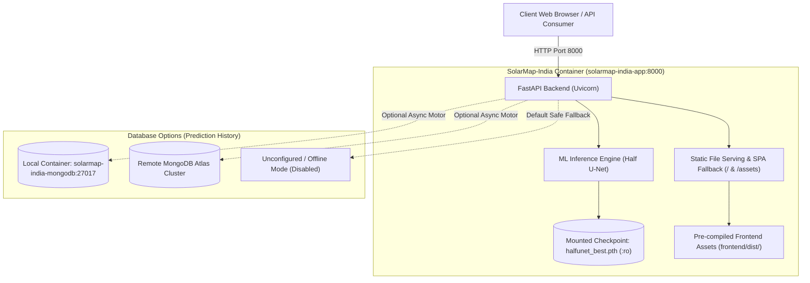

# SolarMap-India: Deployment & Containerization Guide
**Production Deployment, Docker Orchestration, and Artifact Management**

> **Document Status:** Active Production Guide  
> **Target Architecture:** Multi-Stage Docker (Node.js 22 + Python 3.11 Slim with PyTorch CPU)  
> **Associated Roadmap Phase:** Phase 14 (Task 14.1: Containerization & Deployment Orchestration)

---

## 1. Architectural Overview

SolarMap-India is deployed as a unified, production-ready containerized service combining:
1. **Frontend Presentation Layer:** React 19 + Vite 8 Single-Page Application (SPA) with Leaflet geospatial mapping, pre-compiled into static HTML, JavaScript, and CSS bundles during Docker Stage 1.
2. **Backend Application Layer:** FastAPI REST API executing on Python 3.11 with asynchronous endpoint handling, PyTorch Half U-Net segmentation inference, and solar analytics.
3. **Static File Server:** FastAPI directly serves the pre-compiled `frontend/dist/` bundle at root (`/`), with intelligent content negotiation and client-side SPA routing fallback, eliminating the requirement for an external Nginx proxy in standard single-container deployments.
4. **Persistence Layer (Optional):** Asynchronous Motor / MongoDB connection supporting either an external cloud cluster (MongoDB Atlas) or an orchestrated local container (`mongo:7.0-jammy`). The application functions in offline/unconfigured mode if database persistence is omitted.



---

## 2. Prerequisites

### Host System Requirements:
- **Operating System:** Linux (Ubuntu 22.04+ recommended), macOS, or Windows 10/11 with WSL2.
- **Docker Engine:** Docker version 20.10+ (tested with Docker 29.8+).
- **Docker Compose:** Docker Compose v2.0+ (tested with v5.5+).
- **RAM:** Minimum 4 GB recommended (2 GB minimum for inference).
- **Disk Space:** ~2 GB for container image layers.

### Required ML Model Artifact:
- **Model Checkpoint:** `halfunet_best.pth` (~22.2 MB / ~1.93M parameters).
- **Expected Host Path:** `outputs/HalfUNet/models/halfunet_best.pth`.
- **Checkpoint Provenance:** Trained using `Half U-Net.ipynb` (Epoch 18, Best Val Loss 0.2520).
- **Git Policy:** Because binary weights are excluded from Git to prevent repository bloat, developers must supply or mount the checkpoint file.

---

## 3. Model Artifact Provisioning & Verification

Before starting the container or deploying to production, verify that the required checkpoint exists and is valid:

```bash
# Verify the default checkpoint location
python scripts/verify_model_artifact.py

# Or verify a custom checkpoint path
python scripts/verify_model_artifact.py --checkpoint /path/to/halfunet_best.pth
```

### Expected Verification Output:
```text
======================================================================
SOLARMAP-INDIA -- PRODUCTION MODEL ARTIFACT VERIFICATION
======================================================================
Target Checkpoint:  /app/outputs/HalfUNet/models/halfunet_best.pth
Target Device:      cpu (or cuda if GPU available)
File Size:          22.17 MB (23,244,107 bytes)
SHA-256 Checksum:   7a297ade86f7ac8a8c7d6a55c9c0409671f9b5a6f3f0c5c29429610e7e74ac7e
Model Architecture: HalfUNet (Encoder: 3-level, Bottleneck, Decoder: 3-level)
Parameter Count:    1,928,450 (Expected: 1,928,450)
Forward Pass Test:  PASSED (Output shape: torch.Size([1, 2, 256, 256]))

[SUCCESS] MODEL ARTIFACT VERIFIED: Half U-Net is ready for production inference.
======================================================================
```

If the checkpoint is missing, the script exits with status code `1` and outputs troubleshooting instructions.

---

## 4. Environment Variables Reference

Configure environment variables via `.env` file or directly in `docker-compose.yml`:

| Variable Name | Default Value | Description |
| :--- | :--- | :--- |
| `HOST` | `0.0.0.0` | Network binding interface for the backend server. |
| `PORT` | `8000` | Port on which FastAPI listens. |
| `ENVIRONMENT` | `production` | Runtime mode (`production` enables static asset mounts; `development` for local debug). |
| `MODEL_PATH` | `/app/outputs/HalfUNet/models/halfunet_best.pth` | Absolute or relative path to the trained Half U-Net `.pth` file. |
| `FRONTEND_DIST_DIR` | `/app/frontend/dist` | Directory containing the pre-compiled React build. |
| `CORS_ORIGINS` | `*` | Comma-separated list of allowed origins (e.g., `https://solarmap.example.com`). |
| `MONGODB_URI` | `""` (empty) | MongoDB connection string. Leave blank for unconfigured offline mode. |
| `MONGODB_DATABASE` | `solarmap_india` | Database name for persisting prediction records. |
| `MONGODB_COLLECTION` | `predictions` | Collection name for prediction history documents. |
| `MONGODB_SERVER_TIMEOUT_MS` | `3000` | Socket and connection timeout in milliseconds for MongoDB operations. |

---

## 5. Docker Deployment Options

### Option A: Complete Stack via Docker Compose (Recommended)

Starts both the SolarMap-India unified application and a dedicated local MongoDB container:

```bash
# 1. Clone repository
git clone https://github.com/Lohith-25/Lohith-FS-AI.git
cd Lohith-FS-AI

# 2. Ensure model artifact is in place
python scripts/verify_model_artifact.py

# 3. Create .env file from template
cp config/.env.example .env

# Configure .env to use the local containerized MongoDB:
# MONGODB_URI=mongodb://mongodb:27017/solarmap_india

# 4. Build and start services in background
docker compose up -d --build

# 5. Verify service health
docker compose ps
curl http://localhost:8000/health
```

### Option B: Application Only (Without Local Database)

If MongoDB history persistence is not needed, or if connecting to an external MongoDB Atlas cluster:

```bash
# Start only the application service (no local MongoDB container started)
docker compose up -d --build solarmap-app
```

The application starts immediately. The web UI displays the status badge `"Persistence Offline"` and prediction inference operates without interruption.

### Option C: Standalone Docker Run

Run the container directly without Docker Compose:

```bash
# Build the image
docker build -t solarmap-india:latest .

# Run with host model checkpoint volume mount
docker run -d \
  --name solarmap-app \
  -p 8000:8000 \
  -v $(pwd)/outputs/HalfUNet/models:/app/outputs/HalfUNet/models:ro \
  -e MONGODB_URI="mongodb+srv://<user>:<password>@cluster.mongodb.net/?retryWrites=true&w=majority" \
  solarmap-india:latest
```

---

## 6. MongoDB Configuration: Local vs. MongoDB Atlas

### 1. Local Containerized MongoDB
- **URI:** `mongodb://mongodb:27017/solarmap_india`
- **Network Security:** Port `27017` is **not** exposed to the host machine by default. Communication occurs entirely over the internal Docker network `solarmap-network`.
- **Storage:** Persisted on the host via the named Docker volume `solarmap-mongodb-data`.

### 2. Remote MongoDB Atlas (Cloud)
- **URI Format:** `mongodb+srv://<username>:<password>@cluster0.example.mongodb.net/?retryWrites=true&w=majority`
- **Atlas Network Access:** Ensure your MongoDB Atlas IP Access List allows connections from the container host IP (or `0.0.0.0/0` with strong password authentication).
- **Atlas Database User:** Ensure the Atlas user has `readWrite` permissions on database `solarmap_india`.

### 3. Unconfigured / Offline Mode (No Database)
- Leave `MONGODB_URI` blank or undefined.
- The application will log: `[INFO] solarmap.database: MongoDB URI is not configured. Prediction history persistence is disabled.`
- `/health` returns `200 healthy`, while `/health/db` returns `status: "unconfigured"`.
- Image segmentation, metrics calculation, and map visualization remain fully operational.

---

## 7. Health Check and Monitoring Endpoints

| Endpoint | HTTP Method | Expected Status | Description |
| :--- | :---: | :---: | :--- |
| `/health` | `GET` | `200 OK` | Main liveness & readiness probe. Returns `status: "healthy"` when model weights are loaded in memory. Returns `503` if checkpoint is missing. |
| `/health/db` | `GET` | `200 OK` | Persistence probe. Returns `status: "connected"`, `"disconnected"`, or `"unconfigured"` without exposing credentials. |
| `/api` | `GET` | `200 OK` | Machine-readable JSON dictionary of service endpoints and API metadata. |
| `/docs` | `GET` | `200 OK` | Interactive Swagger UI API documentation. |
| `/redoc` | `GET` | `200 OK` | ReDoc API specification. |

---

## 8. Local Development Without Docker

For active development, run the frontend and backend in separate hot-reloading processes:

```bash
# Terminal 1: Start Backend (FastAPI + Uvicorn)
uvicorn backend.main:app --host 127.0.0.1 --port 8000 --reload

# Terminal 2: Start Frontend (Vite)
cd frontend
npm run dev
# Vite runs on http://localhost:5173 with automatic proxying to http://localhost:8000
```

---

## 9. Troubleshooting & Common Issues

### Issue 1: `/health` returns `503 Service Unavailable`
- **Root Cause:** The model checkpoint was not found at the configured `MODEL_PATH`.
- **Fix:** Run `python scripts/verify_model_artifact.py`. Ensure `./outputs/HalfUNet/models/halfunet_best.pth` exists on the host and is mounted to `/app/outputs/HalfUNet/models:ro` in `docker-compose.yml`.

### Issue 2: Frontend loads blank page or 404 on assets
- **Root Cause:** Frontend was not compiled into `frontend/dist/` before running standalone FastAPI.
- **Fix:** In Docker, Stage 1 builds the bundle automatically. For local testing with static serving, run `npm run build` inside `frontend/` first.

### Issue 3: History Drawer shows "Persistence Offline"
- **Root Cause:** MongoDB is not reachable at the configured `MONGODB_URI`.
- **Fix:** Verify MongoDB status via `curl http://localhost:8000/health/db`. If using Docker Compose, ensure `mongodb` service is healthy (`docker compose ps`).

---

## 10. Security & Operational Hardening

1. **Non-Root Execution:** The Docker container drops root privileges and executes as `appuser` (UID/GID 1000).
2. **Read-Only Model Mount:** The model checkpoint directory is mounted `:ro` (read-only) to prevent accidental modification or corruption during inference.
3. **Database Secrets Isolation:** No credentials or database URIs are baked into container images or checked into version control.
4. **Path Traversal Protection:** Static file routes strictly validate path resolution against `FRONTEND_DIST_DIR`, rejecting traversal attempts (`/..%2F..%2F`).
5. **API Guardrails:** Unknown API requests (under `/api/`, `/predict/`, `/outputs/`) strictly return 404 JSON error responses, preventing accidental leakage of HTML error pages to automated API consumers.
