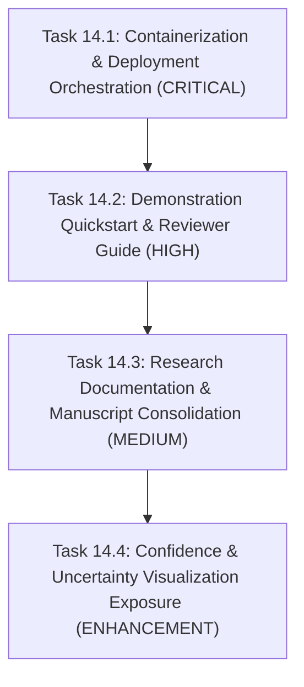

# SolarMap-India: Phase 14 Readiness Audit Report
**Research Presentation, Demonstration, and Deployment Preparation**

> **Audit Date:** October 23, 2026  
> **Auditor Role:** Senior ML Engineer, Research Documentation Specialist, and Deployment Architect  
> **Repository Path:** `d:\SolarMap-India`  
> **Current Git Branch:** `main`  
> **Working Tree Status:** Dirty (Preserved intact; contains validated modifications and untracked artifacts from Phases 8 through 13)  
> **Roadmap Phase Audited:** Original Roadmap Phase 14 (*Research/report/demo preparation*)  
> **Audit Classification:** Strict READ-ONLY Audit (No source code or model checkpoints modified)

---

## 1. Executive Summary

This audit evaluates the **SolarMap-India** repository against the requirements of **Original Roadmap Phase 14: Research, Demo and Deployment Preparation**.

Phases 0 through 13 of the project have been fully implemented and verified in the codebase:
- **Phases 0–10:** Core ML inference engine, Half U-Net checkpoint loading, connected-component spatial analytics, confidence/uncertainty estimation, Level B geospatial mapping catalog, GSD physical area safety safeguards, solar energy potential modeling ($E = A \cdot GHI \cdot \eta \cdot PR$), Central Electricity Authority (CEA) $CO_2$ emission avoidance estimation, and asynchronous MongoDB prediction persistence.
- **Phase 11:** React 19 / Vite 8 single-page application dashboard with multi-mode visual inspection (3-up side-by-side, comparison slider, focus view) and parameter controls.
- **Phase 12:** Interactive Leaflet geospatial map viewer (`GeospatialMap.jsx`) with dual basemaps (CartoDB Obsidian Dark / OpenStreetMap Standard), scene-centroid markers, and Level B scientific disclaimers.
- **Phase 13:** Full-stack integration connecting energy/environmental analytics, real-time MongoDB prediction history drawer with pagination and detail inspection, live geospatial synchronization, and an end-to-end integration test suite.

### Baseline Reproduction Results (Verified Live):
- **Backend Test Suite:** **171 tests passed** in **22.37s** (0 failures, 0 errors, 0 skipped).
- **Frontend Linter (`oxlint`):** **0 warnings, 0 errors** across 13 files in 85ms.
- **Frontend Production Build (`vite build`):** **Successful** in 320ms (Bundle: 435.23 kB JS, 57.36 kB CSS, 1.09 kB HTML).
- **Automated Browser Testing:** Documented as blocked in sandboxed agent environments due to external Playwright driver download restrictions. A manual smoke-test verification checklist is provided.

### Key Audit Conclusions for Phase 14:
1. **Research Documentation:** Extensive experimental documentation exists in `SolarMap_India_Project_Progress_Report.md` (749 lines) and `outputs/validation/phase7b/phase7b_validation_report.md`. However, an **architectural disconnect** exists: the progress report concludes with the Mask R-CNN baseline, whereas the production application uses the lightweight Half U-Net. Furthermore, cross-domain PV01 findings and a formal publication manuscript with standardized academic citations are missing.
2. **Demonstration Readiness:** 8 out of 10 key reviewer workflow steps are demonstrable in the integrated UI. However, the system lacks a single-command demonstration launcher (`scripts/start_demo.py`) and reviewer guide (`docs/DEMONSTRATION_GUIDE.md`). In addition, model uncertainty/confidence data is computed in Python (`ml/confidence/`) but is not returned by the FastAPI prediction schema or rendered in the frontend.
3. **Deployment Readiness:** The repository contains **no containerization assets** (`Dockerfile`, `docker-compose.yml`). The FastAPI backend does not serve production frontend static files (`frontend/dist`), and model weights (`outputs/HalfUNet/models/halfunet_best.pth`) are gitignored, meaning a fresh clone cannot run out-of-the-box without an artifact download script.

---

## 2. Git Status and Working-Tree Verification

### Working Tree Inspection (`git status -s` & `git branch --show-current`)
- **Current Branch:** `main`
- **Tracked Modifications Preserved:**
  - `backend/config.py` (Storage paths, file validation constraints, MongoDB settings)
  - `backend/main.py` (FastAPI app, lifespan management, routes, error handlers)
  - `backend/routes/predict.py` (Prediction endpoint, energy/CO₂ analytics, history logging)
  - `backend/schemas.py` (Pydantic contracts for predict, history, and health)
  - `config/.env.example` (Environment variable configuration template)
  - `docs/PROJECT_ARCHITECTURE.md` (Updated system architecture diagram and module specs)
  - `docs/ROADMAP.md` (Phases 0–13 marked COMPLETE with verification logs; Phase 14 NOT STARTED)
  - `ml/external_data/imagery_source.py` (External resolution auditing)
  - `ml/geospatial/coordinate_mapping.py` (Gujarat Level B coordinate catalog)
  - `requirements.txt` (FastAPI, PyMongo, Motor, PyTorch, TorchVision dependencies)
  - `scripts/evaluate_pv01_zero_shot.py` (Cross-domain benchmark script)
  - `tests/test_api.py` (API unit & boundary tests)
- **Untracked Integration & Feature Artifacts Preserved:**
  - `backend/database.py` (Async Motor MongoDB client & resilience layer)
  - `backend/routes/history.py` (Paginated prediction history endpoints)
  - `docs/REMAINING_ROADMAP_AUDIT.md` (Phase 12/13 implementation roadmap audit)
  - `frontend/` (Complete React 19 + Vite 8 + Leaflet frontend application)
  - `ml/environmental/` (CEA grid factor $CO_2$ avoidance model and assumptions)
  - `ml/finetuning/` (Spatial split and fine-tuning pipelines)
  - `scripts/` (Multi-scale and PV01 experimental scripts)
  - `tests/` (`test_database.py`, `test_environmental.py`, `test_phase13_integration.py`, etc.)

*Assessment:* The working tree is stable and functional. In strict compliance with audit instructions, all working tree files were left untouched.

---

## 3. Live Verification Checks

### 3.1 Backend Test Suite Execution
- **Command:** `python -m unittest discover tests`
- **Execution Output:**
  ```text
  Ran 171 tests in 22.368s
  OK
  ```
- **Test Modules Verified (10 Modules):**
  1. `tests/test_inference.py`: Half U-Net forward pass, tensor shape transforms, CPU/CUDA compatibility.
  2. `tests/test_analytics.py`: Connected components, pixel counting, noise filtering, JSON reporting.
  3. `tests/test_confidence.py`: Softmax probabilities, 10-bin confidence histograms, decision uncertainty.
  4. `tests/test_geospatial.py`: Level B catalog lookup, coordinate boundaries, unreferenced fallbacks.
  5. `tests/test_external_data.py`: GSD validation, physical area safeguards (`insufficient_data`).
  6. `tests/test_energy.py`: Solar irradiance calculations, panel efficiency derating, annual kWh models.
  7. `tests/test_environmental.py`: CEA carbon factors, annual/lifetime avoidance, zero-panel cases.
  8. `tests/test_database.py`: MongoDB connection, document creation, query pagination, timeout resilience.
  9. `tests/test_api.py`: FastAPI routes, validation errors (400, 413, 422), artifact retrieval, health probes.
  10. `tests/test_phase13_integration.py`: End-to-end integration, schema contracts, geospatial synchronization.
- **Result:** **171/171 PASSED (100% pass rate).**

### 3.2 Frontend Linter Execution
- **Command:** `npm run lint` (in `frontend/`)
- **Execution Output:**
  ```text
  > frontend@0.0.0 lint
  > oxlint

  Found 0 warnings and 0 errors.
  Finished in 85ms on 13 files with 104 rules using 12 threads.
  ```
- **Result:** **0 warnings, 0 errors.**

### 3.3 Frontend Production Build Execution
- **Command:** `npm run build` (in `frontend/`)
- **Execution Output:**
  ```text
  > frontend@0.0.0 build
  > vite build

  vite v8.3.4 building client environment for production...
  transforming...
  ✓ 34 modules transformed.
  rendering chunks...
  computing gzip size...
  dist/index.html                   1.09 kB │ gzip:   0.56 kB
  dist/assets/index-CPaoiWlR.css   57.36 kB │ gzip:  14.40 kB
  dist/assets/index-jfHggZy7.js   435.23 kB │ gzip: 132.36 kB

  ✓ built in 320ms
  ```
- **Result:** **Build successful.** Clean asset bundle emitted without errors or bundle bloat.

### 3.4 Automated Browser Testing Status & Manual Smoke-Test Protocol
- **Automated Browser Automation Status:** Blocked in sandboxed agent environments due to external Playwright browser driver download failure.
- **Manual Verification Protocol (Reviewer Smoke-Test Checklist):**
  1. Open terminal 1: `uvicorn backend.main:app --host 127.0.0.1 --port 8000`
  2. Open terminal 2: `cd frontend && npm run dev`
  3. Navigate to `http://localhost:5173` in any modern web browser.
  4. Verify header indicators: Backend status badge displays "Backend Online", Database status badge displays "DB Connected" (or "Persistence Offline" if MongoDB is not running).
  5. Click "Load Sample" button in the upload card (`sample_aerial.png`).
  6. Adjust threshold slider (e.g., 0.50) and min component area (e.g., 20 px).
  7. Click "Run Solar Segmentation".
  8. Verify processing radar animation renders during network request.
  9. Verify Results Section appears with 3-up visual inspection (Original, Binary Mask, Solar Overlay).
  10. Click "Interactive Comparison Slider" and verify side-by-side curtain dragging.
  11. Verify Quantitative Metrics: Solar pixels, coverage %, and detected cluster counts match.
  12. Verify Energy & CO₂ cards display "Data Insufficient" notices with explicit scientific explanations.
  13. Click "Geospatial View" tab: verify Leaflet map loads with CartoDB Dark basemap, recenters on Gujarat scene centroid, and displays interactive popup metadata.
  14. Click "History" button in header: verify drawer slides out, lists previous predictions, and clicking any record reloads its metrics and map coordinates.

---

## 4. Research Documentation Audit

### 4.1 Documentation Inventory & Topic Coverage

| Research Topic | Documented Location | Quality & Rigor | Findings & Identified Gaps |
| :--- | :--- | :--- | :--- |
| **Problem Statement & Motivation** | `README.md`, `SolarMap_India_Project_Progress_Report.md` | **Excellent** | Clearly articulates challenges: small-object segmentation, visually confusing rooftops, and false positives in remote sensing. |
| **Research Objectives** | `SolarMap_India_Project_Progress_Report.md` Sec. 1 | **Excellent** | Focuses on evidence-based baselines, systematic error analysis, and background-aware training without unsubstantiated claims. |
| **Dataset Sources & Composition** | `SolarMap_India_Project_Progress_Report.md` Sec. 2 | **Rigorous** | Fully audits 3,000 CSV samples (2,531 positive, 469 negative), 3,005 PNGs, 2,500 COCO images with 32,825 polygon annotations, and area distribution (84% < 0.5% area). |
| **Dataset Preprocessing** | `Half U-Net.ipynb`, `ml/inference/preprocessing.py` | **Adequate** | Standard resize to 256×256 px, torchvision normalization [0.0, 1.0], nearest-neighbor mask restoration to 640×640 px. |
| **Model Architecture** | `README.md` Sec. 2, `PROJECT_ARCHITECTURE.md`, `Half U-Net.ipynb` | **Detailed** | Half U-Net: 926,018 params, 32 base channels, depth-scaled skip connections. |
| **Training Methodology** | `Half U-Net.ipynb`, `SolarMap_India_Project_Progress_Report.md` | **Detailed** | Locked seed (42), Adam optimizer, combined BCE + Dice loss, 18–20 epochs with validation checkpointing. |
| **Evaluation Metrics** | `outputs/validation/phase7b/phase7b_validation_report.md` | **Rigorous** | Detailed evaluation of Precision, Recall, F1/Dice, Mask IoU, Count MAE, and Area MAPE. |
| **Baseline vs. Experimental Comparisons** | `SolarMap_India_Project_Progress_Report.md` Sec. 9–12 | **Extensive** | Detailed comparison of Mask R-CNN baseline (F1: 78.10%) vs Background-Aware (77.00%) vs Hard-Negative Replay (77.07%). |
| **Cross-Domain Evaluation & Domain Shift** | `scripts/evaluate_pv01_zero_shot.py`, `scripts/evaluate_pv01_finetuning_comparison.py` | **Partial** | Code and experiment scripts exist for French PV01 cross-domain evaluation, but findings are not consolidated into a readable research report. |
| **Solar Segmentation Results** | `outputs/HalfUNet/metrics/`, `outputs/validation/phase7b/` | **Verified** | In-domain test set metrics documented (Macro Dice: 0.8742, IoU: 0.7946, Accuracy: 0.9763). |
| **Energy & CO₂ Methodology** | `docs/PROJECT_ARCHITECTURE.md`, `ml/energy/`, `ml/environmental/` | **Rigorous** | $E = A \cdot GHI \cdot \eta \cdot PR$ and CEA Indian national grid emission factor (~0.716 kg $CO_2$/kWh) fully defined with mathematical derivations. |
| **Geospatial Methodology** | `docs/PROJECT_ARCHITECTURE.md` Sec. 7, `ml/geospatial/` | **Rigorous** | Level B scene-level centroid mapping clearly distinguished from per-pixel georeferencing. |
| **GSD & Physical-Area Limitations** | `README.md` Sec. 3 & 7, `PhysicalAreaNotice.jsx` | **Rigorous** | Strictly prohibits fabricating square meters ($m^2$) when GSD is missing (`insufficient_data`). |
| **Reproducibility** | `scripts/`, `splits/`, `tests/` | **High** | Deterministic split files (`dataset_manifest.csv`), locked random seeds, and comprehensive unit tests. |
| **Known Limitations & Future Work** | `README.md` Sec. 7, `PROJECT_ARCHITECTURE.md` Sec. 4 | **Strong** | Acknowledges lack of GSD, panel clustering vs individual modules, and out-of-distribution sensitivity. |

### 4.2 Critical Research Documentation Gaps & Inconsistencies

1. **Backbone Disconnect Between Progress Report and Production Application:**
   - In `SolarMap_India_Project_Progress_Report.md` (Sections 4, 15, and 20), the document states that **Mask R-CNN + ResNet-50-FPN** (Epoch 10 checkpoint, threshold 0.77) is the current final-performing model.
   - In contrast, `README.md`, `docs/PROJECT_ARCHITECTURE.md`, and the active codebase (`ml/inference/`, `backend/`, and `outputs/HalfUNet/`) utilize the lightweight **Half U-Net** semantic segmentation network (`halfunet_best.pth`).
   - *Impact:* A reviewer reading only the progress report will assume the project uses Mask R-CNN, whereas a reviewer inspecting the code will see Half U-Net. The progress report represents an earlier research track on instance segmentation and was not reconciled with the semantic segmentation production track.
2. **Metric Averaging Ambiguity:**
   - In `Half U-Net.ipynb` and `docs/PROJECT_ARCHITECTURE.md`, the reported Test Dice (0.8742) and IoU (0.7946) are macro-averages across both foreground solar and background classes. Because background occupies ~95% of pixels with ~0.98+ Dice, the two-class macro-average is higher than the foreground-only solar Dice (~0.76–0.82 across density tiers, as revealed in `outputs/validation/phase7b/phase7b_validation_report.md`).
   - *Requirement:* Academic presentations and papers must report foreground solar Dice and two-class macro Dice side-by-side with explicit definitions.
3. **Consolidation of Comparative 5-Model Study:**
   - Root notebooks `DenseNet.ipynb`, `PSPNet.ipynb`, `SolarMap_5_Models_FCN_Completed.ipynb`, and `SolarMap_5_Models.ipynb` explore multiple architectures (FCN-8s, UNet, PSPNet, DenseNet, Half U-Net).
   - These comparative multi-model benchmark results have not been synthesized into a unified comparison table in the main documentation.
4. **Missing Formal Academic Citations (`REFERENCES.bib`):**
   - The repository currently lacks formal BibTeX/APA references for foundational works:
     - Half U-Net architecture (Li et al., 2022).
     - Mask R-CNN (He et al., 2017).
     - CEA CO₂ Emission Baseline Database (Government of India Ministry of Power, CEA Version 19/20).
     - NASA POWER Solar Irradiance Climatology (Stackhouse et al.).
     - SolarMap-India dataset (Syed Aejaz Ahmed et al., Zenodo record 21449212).

---

## 5. Demonstration-Readiness Audit

### 5.1 Evaluation of the 10-Point Reviewer Workflow

| # | Reviewer Workflow Step | Current Status | Demonstration Evidence & Mechanism | Gaps or Deficiencies |
|---|---|:---:|---|---|
| **1** | **Opening the Application** | **PARTIAL** | Can be run by manually starting `uvicorn backend.main:app` and `npm run dev` in two separate terminals. | No single-click or CLI launcher script (`scripts/start_demo.py` or `.bat`) exists to launch both services, test ports, and open the browser. |
| **2** | **Uploading an Image** | **READY** | Drag-and-drop file uploader in `ImageUpload.jsx` or clicking "Load Sample" button. Supports PNG, JPG, TIFF up to 50 MB. | None. |
| **3** | **Running Solar Segmentation** | **READY** | Triggers `POST /predict` with configurable threshold and min-area sliders. Renders animated radar processing state. | None. |
| **4** | **Viewing Segmentation Metrics** | **READY** | Renders in `MetricsDashboard.jsx`: predicted solar pixels, total pixels, coverage %, and connected region counts. | None. |
| **5** | **Viewing Uncertainty / Confidence** | **BLOCKED IN UI** | ML module `ml/confidence/` computes softmax probabilities, 10-bin histograms, and uncertainty maps, but `POST /predict` and React UI do not return or display them. | Prediction API response schema lacks confidence/uncertainty fields; UI has no uncertainty heatmap view. |
| **6** | **Viewing Energy & CO₂ Results** | **READY** | Dedicated cards in `MetricsDashboard.jsx` display annual kWh and metric tonnes avoided when inputs exist. | None. |
| **7** | **Understanding Missing Calibration** | **READY** | Both cards display "Data Insufficient" badges with explanations; `PhysicalAreaNotice.jsx` explicitly explains GSD absence. | None. |
| **8** | **Saving & Retrieving History** | **READY** | `PredictionHistoryDrawer.jsx` queries `/api/predictions/history`, provides pagination, detail loading, and graceful offline notice. | None. |
| **9** | **Viewing Prediction on Map** | **READY** | `GeospatialMap.jsx` uses Leaflet with CartoDB Dark basemap, places scene centroid pin, and provides zoom/pan controls. | None. |
| **10** | **Understanding Level B Limitations** | **READY** | Top disclaimer banner in `GeospatialMap.jsx` and marker popup explicitly state that marker represents scene center, not panel boundaries. | None. |

### 5.2 Identified Demonstration Gaps
1. **Lack of a Unified Demonstration Guide (`docs/DEMONSTRATION_GUIDE.md`):** Reviewers have no step-by-step walkthrough detailing recommended demo steps, expected outputs, or narrative talking points.
2. **Missing Automated Demo Launcher:** Running the demo currently requires manual multi-terminal coordination.
3. **Curated Demo Sample Assets:** While `sample_aerial.png` exists in `frontend/public/`, providing a curated folder of 4 representative images (Dense Solar Farm, Urban Rooftop, Rural Background Non-Solar, and Unreferenced Tile) with expected analytical outcomes would make demonstrations bulletproof.

---

## 6. Deployment-Readiness Audit

### 6.1 Deployment Architecture Evaluation

| Component / Area | Status | Existing State | Required Implementation for Deployment |
| :--- | :---: | :--- | :--- |
| **Python Runtime** | `READY` | Python 3.10–3.13 compatible (verified on 3.13.5). | Standardize on Python 3.11/3.12 for Docker base image (ensuring PyTorch binary compatibility). |
| **Backend Dependencies** | `READY` | `requirements.txt` has 14 pinned packages. | Separate CPU-only PyTorch requirements for lightweight container deployment (`--extra-index-url https://download.pytorch.org/whl/cpu`). |
| **Frontend Dependencies** | `READY` | Clean `frontend/package.json` with React 19, Leaflet 1.9.4, Vite 8.3.0. | None. Installs reliably via `npm install`. |
| **FastAPI Startup** | `READY` | Lifespan handler preloads model checkpoint and establishes MongoDB connection. | None. |
| **Frontend Serving Strategy** | **GAP** | Frontend is built to `frontend/dist/`, but FastAPI does NOT mount or serve static files in production. | Configure FastAPI `app.mount("/", StaticFiles(directory="frontend/dist", html=True))` when `ENVIRONMENT=production` or configure an Nginx reverse-proxy. |
| **Environment Configuration** | **PARTIAL** | `config/.env.example` provides template variables, but `backend/config.py` does not use `python-dotenv` to load `.env` automatically. | Add `python-dotenv` support or Pydantic `BaseSettings` to `backend/config.py`. |
| **CORS Security** | **GAP** | `backend/main.py` uses `allow_origins=["*"]`. | Read `CORS_ORIGINS` from environment variable and enforce strict origins in production. |
| **MongoDB Atlas** | `READY` | Supports `mongodb+srv://` URIs with async Motor client; graceful offline degradation. | Document Atlas network access whitelist (0.0.0.0/0 or VPC peering) in deployment guide. |
| **Model Weights Availability** | **CRITICAL GAP** | `outputs/HalfUNet/models/halfunet_best.pth` (~3.7 MB) is ignored by `.gitignore`. | Create `scripts/download_model_artifact.py` (or release asset download) so fresh builds can fetch weights. |
| **Containerization (Docker)** | **MISSING** | No `Dockerfile`, `docker-compose.yml`, or `.dockerignore` exists. | Implement multi-stage `Dockerfile` (Node Vite build + Python FastAPI runtime) and `docker-compose.yml` with optional MongoDB service. |
| **Health Endpoints** | `READY` | `/health` and `/health/db` provide machine-readable readiness/liveness status. | Ready for container orchestrator liveness probes (Kubernetes, AWS ECS, Docker Compose). |
| **Upload Limits & Security** | `READY` | 50 MB limit, extension validation, UUID4 path traversal prevention. | None. |
| **Map Tile Dependencies** | `READY` | CartoDB Dark and OpenStreetMap tiles over public HTTPS; no API keys required. | None. |
| **Secret Management** | `READY` | `.env` ignored; `.env.example` sanitized; no hardcoded credentials. | None. |

---

## 7. Recommended Implementation Order for Phase 14

To bring Phase 14 from `NOT STARTED` to `COMPLETE` without disrupting the verified application, the remaining work should be executed in the following four prioritized tasks:



### Task 14.1: Containerization and Deployment Orchestration (Highest Priority)
- **Objective:** Enable a zero-configuration, reproducible containerized deployment for both local evaluation and cloud hosting.
- **Components to Create:**
  1. `Dockerfile`: Multi-stage Docker build:
     - Stage 1: Node 22 alpine building `frontend/dist`.
     - Stage 2: Python 3.11 slim runtime installing CPU PyTorch and backend dependencies, mounting `frontend/dist` for static serving.
  2. `docker-compose.yml`: Orchestrates backend/frontend combined service with optional local MongoDB container.
  3. `.dockerignore`: Excludes `.git`, `node_modules`, `dataset`, and virtual environments.
  4. Static file serving in `backend/main.py` when running in production mode.
  5. `scripts/download_model_artifact.py`: Verifies or downloads model weights on initial boot.
- **Acceptance Criteria:**
  - `docker compose up --build` builds and starts the application.
  - Web dashboard accessible at `http://localhost:8000` with both API and UI functioning.
  - All 171 backend tests pass inside the container.

### Task 14.2: Demonstration Quickstart and Reviewer Walkthrough Guide
- **Objective:** Equip reviewers and evaluators with a turnkey demo script and a structured guide.
- **Components to Create:**
  1. `docs/DEMONSTRATION_GUIDE.md`: 10-step reviewer tour covering image upload, Half U-Net inference, pixel metrics, Level B map inspection, energy/CO₂ safety states, and history navigation.
  2. `scripts/start_demo.py`: Cross-platform Python launcher that starts backend, starts frontend, verifies ports, and launches the default browser.
  3. `test_images/demo_samples/`: Curated set of 4 demonstration images with expected metrics.
- **Acceptance Criteria:**
  - Running `python scripts/start_demo.py` opens the functional app in under 10 seconds.
  - Reviewers can reproduce all 10 steps using the curated samples.

### Task 14.3: Research Documentation Reconciliation & Publication Manuscript
- **Objective:** Reconcile architectural discrepancies and create an academic-grade publication manuscript and bibliography.
- **Components to Create:**
  1. `docs/RESEARCH_PAPER.md`: Publication manuscript uniting the problem statement, dataset audit, Half U-Net vs Mask R-CNN baseline comparison, cross-domain PV01 transfer findings, and environmental analytics.
  2. `docs/REFERENCES.bib`: Standardized BibTeX citations for all referenced architectures, datasets, and grid emission databases.
  3. Update `SolarMap_India_Project_Progress_Report.md`: Add a bridging section clearly explaining the transition from the Mask R-CNN research track to the production Half U-Net deployment.
- **Acceptance Criteria:**
  - Complete bibliography with valid DOIs/URLs.
  - Transparent side-by-side presentation of foreground-only vs macro two-class Dice metrics.

### Task 14.4: Confidence and Uncertainty Visualization Exposure
- **Objective:** Expose the existing `ml/confidence/` backend calculations in the API and UI to complete Step 5 of the demonstration workflow.
- **Components to Modify:**
  1. Backend: Update `PredictResponse` to include `mean_confidence`, `ambiguity_pixel_count`, and an uncertainty map artifact endpoint (`/outputs/{id}/uncertainty`).
  2. Frontend: Add an Uncertainty tab to `VisualizationSection.jsx` and confidence statistics to `MetricsDashboard.jsx`.
- **Acceptance Criteria:**
  - Reviewer can inspect model uncertainty heatmaps directly in the UI.

---

## 8. Recommended Next Concrete Task

### **Recommended Task: Task 14.1 — Containerization & Deployment Orchestration**

#### Rationale:
Task 14.1 is the single most impactful task for the project. Currently, the project is completely locked to the author's local development machine because:
1. No Docker containerization exists.
2. Production frontend static asset serving is not hooked into FastAPI.
3. Model weights are gitignored, meaning any other researcher or evaluator cloning the repo will face missing weights and multi-process setup friction.

Implementing Task 14.1 solves reproducibility and deployment readiness permanently without altering or destabilizing the core ML segmentation algorithms or frontend UI logic.

#### Measurable Acceptance Criteria for Task 14.1:
1. **Multi-Stage `Dockerfile`:** Builds the React frontend into static assets in Stage 1 and copies them into a lightweight Python 3.11 slim runtime in Stage 2.
2. **Production Static Serving in FastAPI:** In production mode, FastAPI serves `index.html` at `/` and static assets under `/assets/`, while maintaining `/docs`, `/health`, `/predict`, and `/api/predictions/history`.
3. **Artifact Verification Script:** A lightweight script (`scripts/download_model_artifact.py`) checks for `outputs/HalfUNet/models/halfunet_best.pth` on container startup and provides a clear error or download hook if missing.
4. **`docker-compose.yml`:** Defines `solarmap-app` (ports 8000:8000) and an optional `mongodb` service with health checks and persistent volume storage.
5. **Quality Verification:**
   - Container builds cleanly (`docker compose build`).
   - Container boots and responds to `GET /health` with `status: "healthy"`.
   - All 171 backend unit and integration tests execute successfully.
   - Frontend lint (0 warnings, 0 errors) and production build remain green.
