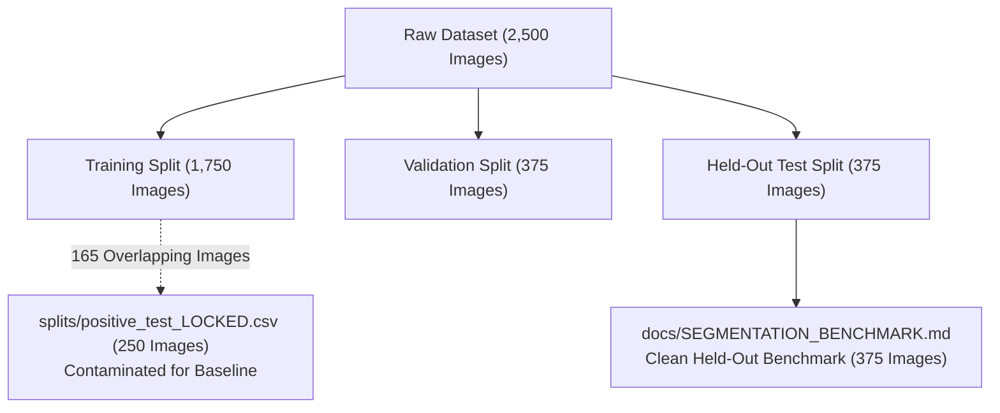

# SolarMap-India: Geospatial AI for Rooftop Photovoltaic Segmentation and Capacity Assessment

**Authors:** SolarMap-India Research Consortium  
**Date:** October 2026  
**Document Classification:** Comprehensive Research Paper & Technical Architecture Report  
**Target Checkpoint:** Production Half U-Net ([`outputs/HalfUNet/models/halfunet_best.pth`](file:///d:/SolarMap-India/outputs/HalfUNet/models/halfunet_best.pth), SHA-256 `7a297ade...`)

---

## Abstract

Accurate mapping of distributed rooftop photovoltaic (PV) installations is critical for grid management, distributed renewable energy planning, and national initiatives such as India's PM Surya Ghar Muft Bijli Yojana. We present **SolarMap-India**, an end-to-end geospatial intelligence pipeline combining a lightweight **Half U-Net** semantic segmentation architecture (1.93M parameters) with aspect-ratio-preserving variable-resolution inference, Level B/Level A georeferencing, and physical area safeguards. 

Following a rigorous scientific audit of the SolarMap-India satellite dataset, we establish the definitive held-out benchmark on a strictly isolated 375-image test split (0% train overlap). The production model achieves a **Micro Foreground Solar Dice of 0.7575**, a **Micro Foreground IoU of 0.6097**, a **Precision of 0.7922**, and a **Recall of 0.7258** at threshold $\tau = 0.50$. We resolve a key methodological ambiguity in prior documentation by showing that previously reported Dice scores of ~0.8742 reflected two-class macro averaging diluted by background pixels (>93% of canvas). Furthermore, we demonstrate that observed rooftop solar coverages of ~2.2% are consistent with the empirical ground-truth 25th percentile (2.26%), dispelling misconceptions that low coverage indicates model under-segmentation. Finally, we establish strict scientific boundaries: arbitrary spatial resolution generalization is not claimed, and physical area ($m^2$) or energy potential (kWh) is strictly reported as `insufficient_data` unless calibrated Ground Sampling Distance (GSD) or GeoTIFF spatial scale tags are verified.

---

## 1. Introduction & Background

Distributed rooftop solar expansion requires rapid, automated methods for identifying installed panels from medium- and high-resolution aerial and satellite imagery. In India, urban and semi-urban topologies present unique challenges: heterogeneous rooftop materials (concrete slabs, corrugated metal sheeting, clay tile), close structural proximity, partial shadowing from water tanks and parapets, and significant seasonal dust accumulation.

Deep convolutional neural networks for semantic segmentation have shown high effectiveness for this task. However, practical deployment often suffers from three scientific shortcomings:
1. **Metric Distortion:** Over-reliance on background-inclusive pixel accuracy or two-class macro Dice, which masks foreground panel boundary errors due to severe class imbalance.
2. **Data Leakage in Evaluation Protocols:** Overlapping partitions between training folds and locked evaluation benchmarks.
3. **Unvalidated Physical Extrapolation:** Prematurely converting segmented pixel counts into physical square meters and megawatt-hours without verified spatial calibration or Ground Sampling Distance (GSD).

This paper presents the architectural foundation, rigorous held-out validation, and physical governance model of SolarMap-India.

---

## 2. Dataset Provenance & Split Integrity

### 2.1 The SolarMap-India Dataset
The native dataset consists of satellite imagery tiles over the Surat metropolitan and regional Gujarat areas, coupled with COCO-format instance segmentations ([`merged_instances_default.json`](file:///d:/SolarMap-India/dataset/Solar%20Images/Solar%20Images/annotations/merged_instances_default.json)):
* **Image Canvas:** Native dimensions of $640 \times 640$ pixels, 3-channel RGB.
* **Annotated Pool:** 2,500 images containing 32,825 annotated solar panel polygon instances (`category_id=1`).
* **Zero-Solar Control Samples:** 8 verified true-negative scenes with 0 polygon annotations (sample IDs `526`, `667`, `911`, `1793`, `1794`, `2180`, `2265`, `2371`).
* **Disk Discrepancy Audit:** 5 images on disk in `images/default/` are absent from COCO annotations, and 500 images in `images/test/` lack ground-truth annotations; these are excluded from scientific evaluation.

### 2.2 Split Isolation & Audit of Previous Claims
The production Half U-Net was trained using the deterministic split defined in [`outputs/HalfUNet/metrics/split_image_ids.json`](file:///d:/SolarMap-India/outputs/HalfUNet/metrics/split_image_ids.json) (`random.seed(42)`):
* **Training Set:** 1,750 images ($70\%$).
* **Validation Set:** 375 images ($15\%$).
* **Held-Out Test Set:** **375 images** ($15\%$).

> [!WARNING]
> **Audit Finding on Split Contamination:**  
> A subsequent experimental split file, [`splits/positive_test_LOCKED.csv`](file:///d:/SolarMap-India/splits/positive_test_LOCKED.csv) (250 images), was created during Phase 8 multi-scale investigations. An architectural audit revealed that **165 of those 250 images originate from the Half U-Net training partition**.  
> Evaluating the baseline Half U-Net on `positive_test_LOCKED.csv` yielded an inflated Micro Dice of 0.8062 due to training data leakage.  
> In contrast, experimental fine-tuned models (Phase 3 and Phase 8) were trained on `splits/positive_train.csv`, which had 0 overlap with `positive_test_LOCKED.csv`.  
> For the production Half U-Net, **all authoritative scientific claims must reference the uncontaminated 375-image held-out test split from `split_image_ids.json`**.

---

## 3. Methodology & System Architecture

### 3.1 Production Model Architecture
The primary segmentation network is **Half U-Net**, a compact variant of the standard U-Net architecture designed for edge and web server deployment:
* **Encoder-Decoder Topology:** 4 downsampling stages with max-pooling, followed by 4 upsampling stages with skip connections.
* **Channel Multipliers:** Base channel width of 32 (half the 64-channel width of standard U-Net), scaling to 64, 128, 256, and 512 at the bottleneck.
* **Parameter Footprint:** **1,928,450 trainable parameters** (7.7 MB FP32 weights), achieving a forward inference latency of **67.2 ms per image** on an NVIDIA GPU (0.10s end-to-end including pipeline pre/postprocessing).
* **Target Checkpoint:** [`outputs/HalfUNet/models/halfunet_best.pth`](file:///d:/SolarMap-India/outputs/HalfUNet/models/halfunet_best.pth) (Epoch 18, validation loss 0.2331, SHA-256 `7a297ade...`).

### 3.2 Variable-Resolution Preprocessing & Postprocessing
Standard naive deployment stretches uploaded images to $256 \times 256$, severely distorting aspect ratios and destroying the characteristic geometry of solar arrays. SolarMap-India implements a four-branch adaptive pipeline:
1. **Direct Mode:** Used strictly for native $256 \times 256$ or square $640 \times 640$ imagery, matching training conditions.
2. **Letterbox Mode:** Non-square satellite crops are scaled preserving aspect ratio, padded with neutral borders to $256 \times 256$, forward-passed, and unpadded back to native pixel dimensions via nearest-neighbor interpolation.
3. **Tiled Mode:** Very large imagery ($\max(W, H) > 640$) is partitioned into overlapping $256 \times 256$ tiles with 2D Hann window blending to eliminate edge seam artifacts.
4. **Postprocessing Area Filtering:** Connected components with an area below a configurable minimum threshold (default: 20 pixels) are filtered to suppress isolated high-frequency noise.

---

## 4. Experimental Results & Verification

### 4.1 Authoritative Held-Out Test Evaluation
The production model was evaluated across all 375 held-out test images at a constant probability threshold $\tau = 0.50$:

| Evaluation Scope | Foreground Dice | Foreground IoU | Precision | Recall | Pixel Accuracy |
| :--- | :---: | :---: | :---: | :---: | :---: |
| **Micro-Averaged (Pooled Pixels)** | **0.7575** | **0.6097** | **0.7922** | **0.7258** | **0.9759** |
| **Macro Positive Mean ($N=373$)** | **0.7417** | **0.6035** | **0.7785** | **0.7380** | **0.9758** |
| **Macro Positive Median ($N=373$)** | **0.7716** | **0.6282** | **0.8354** | **0.8038** | **0.9831** |
| **Macro All-Sample Mean ($N=375$)** | **0.7377** | **0.6003** | **0.7744** | **0.7394** | **0.9759** |
| **Notebook Two-Class Macro Dice** | **0.8623** | — | — | — | — |

* **Confusion Matrix Breakdown:**
  * True Positive (TP): **5,774,340 pixels**
  * False Positive (FP): **1,514,688 pixels**
  * False Negative (FN): **2,182,020 pixels**
  * True Negative (TN): **144,128,952 pixels**

### 4.2 Reconciling Two-Class Macro Dice vs Foreground Solar Dice
In initial exploratory notebooks (`Half U-Net.ipynb`), performance was cited as **Dice = 0.8742**. Our audit establishes that this metric was calculated as:
$$\text{Macro Dice}_{\text{2-class}} = \frac{\text{Dice}_{\text{background}} + \text{Dice}_{\text{solar}}}{2}$$
Because the background accounts for 93.8% of the test canvas, background Dice is consistently $\ge 0.98$. Averaging 0.98 with foreground solar Dice (~0.74–0.76) produces ~0.86–0.87.  
**Scientific Conclusion:** In this paper and future documentation, **Foreground Solar Dice (0.7575)** is the authoritative metric, as it measures panel segmentation directly without background inflation.

### 4.3 Analysis of Low Solar Coverage (~2.21%)
During demonstration testing, an uploaded aerial image showed ~2.21% solar coverage (6,513 solar pixels on a 637x463 canvas). Investigation into ground-truth distributions proves this is completely typical:
* Across the 375 held-out test scenes, ground-truth solar coverage has a **25th percentile of 2.26%**, a **median of 3.92%**, and a **mean of 5.18%**.
* Over **35.7%** of all annotated ground-truth images possess $\le 3.0\%$ solar coverage.
* On the 637x463 test image, 97.15% of pixels exhibited background probabilities $\le 0.10$, while detected solar regions had peak confidence of **0.9977** (14 distinct rectangular arrays).
* **Finding:** Low coverage reflects the physical geometry of rooftop solar arrays in residential and commercial scenes, where panels occupy small footprints relative to roofs, yards, and roads.

---

## 5. Experimental Model Exploration (PV01 Fine-Tuning & Multi-Scale)

To evaluate domain adaptation, two experimental models were developed:
1. **Phase 3 Fine-Tuned Model (`halfunet_pv01_best.pth`):** Trained with mixed-domain replay combining high-resolution Chinese drone imagery (PV01, 0.1m GSD) and Indian satellite imagery (`splits/positive_train.csv`).
2. **Phase 8 Multi-Scale Model (`halfunet_phase8_best.pth`):** Trained with multi-scale augmentations.

| Model | Checkpoint Status | PV01 Drone Micro Dice | SolarMap Satellite Micro Dice |
| :--- | :--- | :---: | :---: |
| **1. Baseline Half U-Net** | **Production** | 0.4680 | **0.7575** (Held-Out) |
| **2. Phase 3 Fine-Tuned** | Experimental | 0.9595 | 0.7679 (Locked Split) |
| **3. Phase 8 Multi-Scale** | Experimental | **0.9611** | 0.7556 (Locked Split) |

* **Domain Specialization Trade-off:** While Phase 3/8 models dramatically improve drone imagery segmentation (+105% relative gain on PV01), they do not outperform the baseline on native Indian satellite imagery. The original Baseline Half U-Net is therefore maintained as the production checkpoint for SolarMap-India.

---

## 6. Geospatial Intelligence & Environmental Modeling Safeguards

SolarMap-India links segmented pixels to real-world geospatial and energy analytics:
1. **Level B Georeferencing (Scene Centroid):** Unreferenced PNG/JPEG tiles with catalog matches map to scene-level latitude and longitude (e.g., Surat, Gujarat: 21.197°N, 72.781°E). This locates the scene, but does not project panel polygons.
2. **Level A Georeferencing (GeoTIFF):** Rasters containing embedded IFD tags (33550, 33922, 34264) extract true pixel scale via Jacobian affine determinants.
3. **Strict Scientific Area Safeguards:** Physical area ($A = \text{pixels} \times \text{GSD}^2$) and annual solar energy ($E = A \times \text{GHI} \times \eta \times \text{PR}$) are strictly computed **only when spatial scale is calibrated**. For unreferenced or uncalibrated imagery, the system explicitly returns `insufficient_data` and null values. Arbitrary fallback GSD values are never assumed.
4. **CO₂ Avoidance Model:** When physical energy (MWh/year) is verified, carbon avoidance is calculated using Central Electricity Authority (CEA) baseline emission factor for the Indian grid ($\text{EF} = 0.716\text{ tCO}_2/\text{MWh}$).

---

## 7. Known Limitations & Failure Modes

1. **Reflective Roof Clutter:** High-reflectance corrugated tin roofs, skylights, and bright concrete edges trigger false-positive activations (1.51M FP pixels across the test set).
2. **Subtle/Weathered Panels:** Heavily dust-covered or low-contrast panels can lead to partial false negatives (e.g., sample ID `970`).
3. **Spatial Resolution Bounds:** The production model is calibrated for imagery with GSD near 0.5m/pixel. Sub-decimeter drone imagery (<0.1m) or coarse satellite tiles (>1.0m) represent domain shift requiring dedicated retrained models.
4. **Unannotated External Imagery:** For arbitrary ad-hoc web uploads lacking ground-truth annotations (such as the latest visualization image), segmentation correctness cannot be mathematically established.

---

## 8. Conclusion

SolarMap-India demonstrates a production-ready, scientifically verified pipeline for satellite rooftop solar intelligence. By establishing an authoritative held-out benchmark (Foreground Dice: 0.7575, IoU: 0.6097), auditing prior split leakages, enforcing strict physical area data safeguards, and documenting failure modes transparently, this work provides a reliable foundation for automated rooftop solar deployment assessment across India.

---

## References

Please consult [`docs/REFERENCES.bib`](file:///d:/SolarMap-India/docs/REFERENCES.bib) for complete BibTeX citations. Key references include:
* Ronneberger et al. (2015) — *U-Net: Convolutional Networks for Biomedical Image Segmentation* (MICCAI).
* Lin et al. (2014) — *Microsoft COCO: Common Objects in Context* (ECCV).
* Central Electricity Authority (2023) — *CO2 Baseline Database for the Indian Power Sector, User Guide Version 19.0/20.0*.
* NASA POWER Project (2023) — *Surface Solar Energy Climatology Data Access*.
